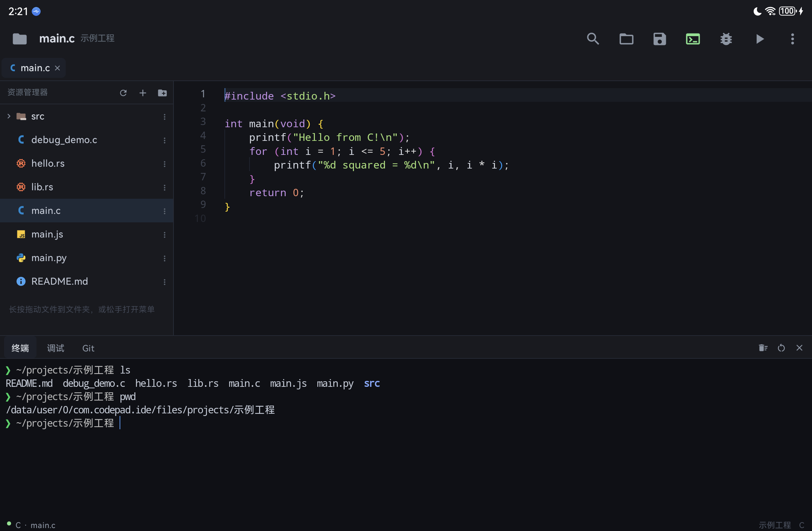
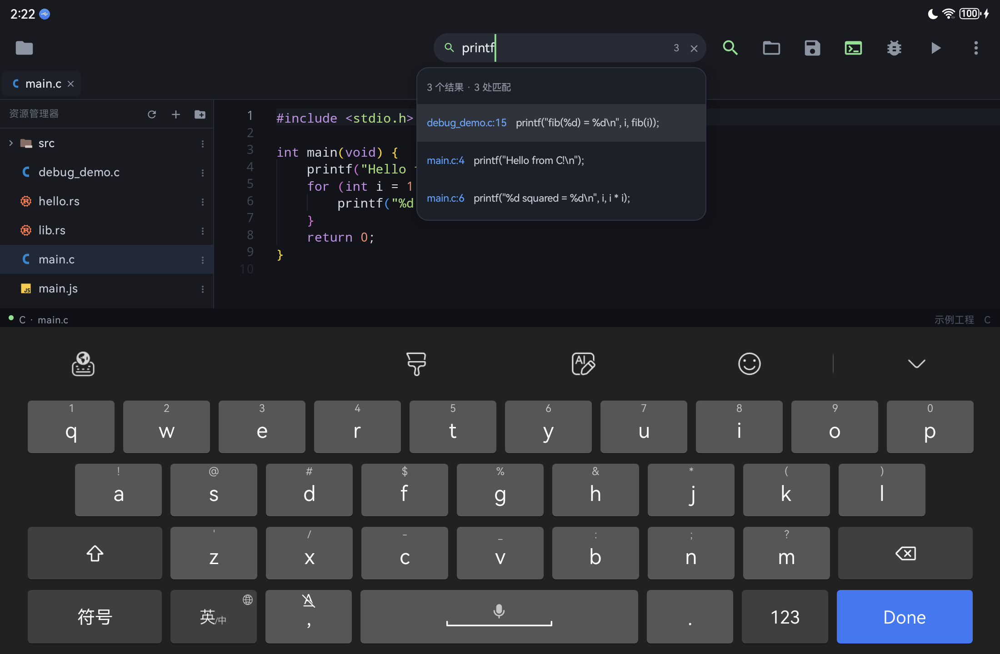
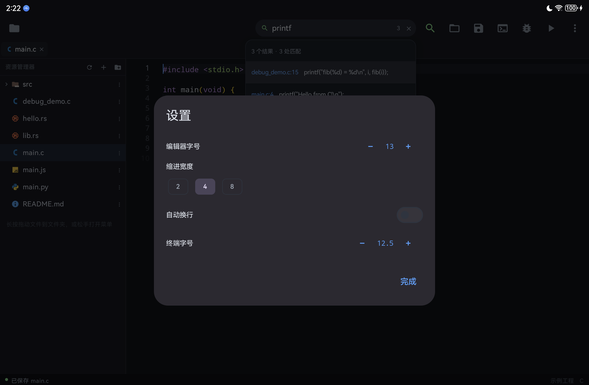
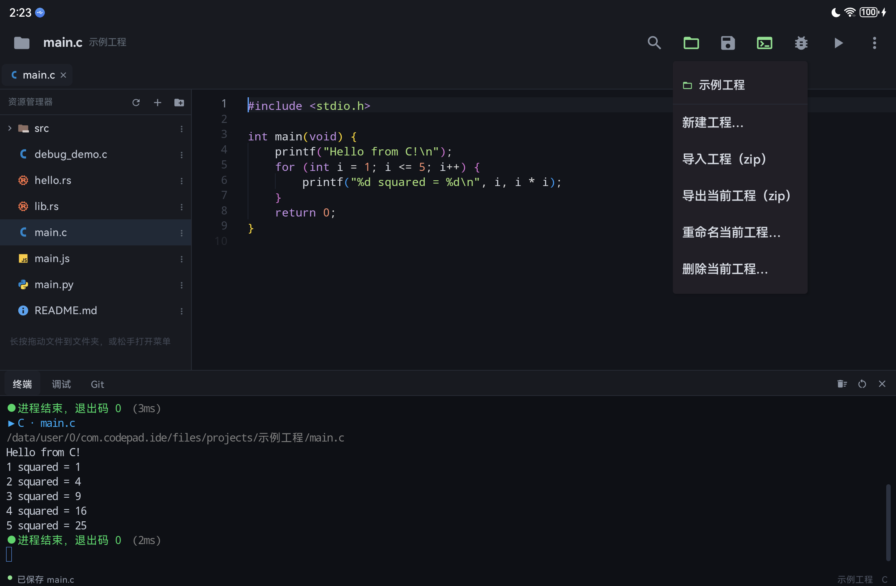
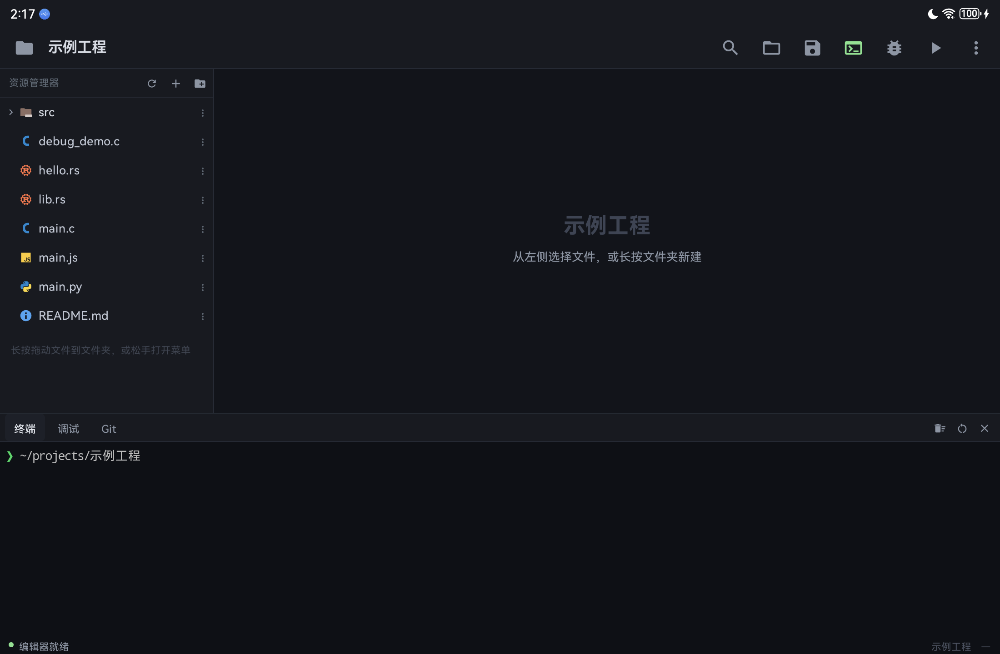
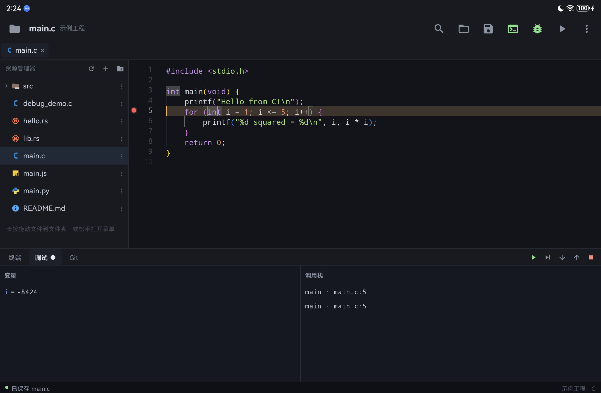
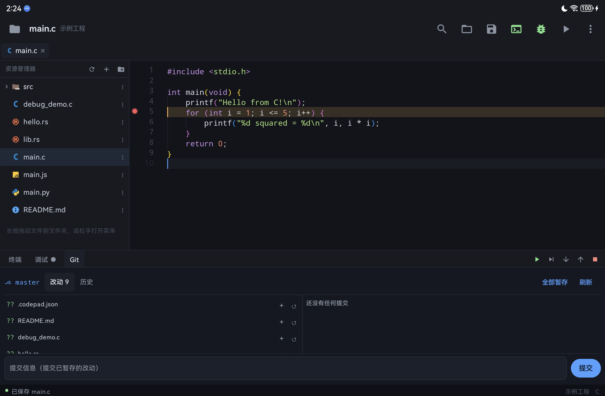
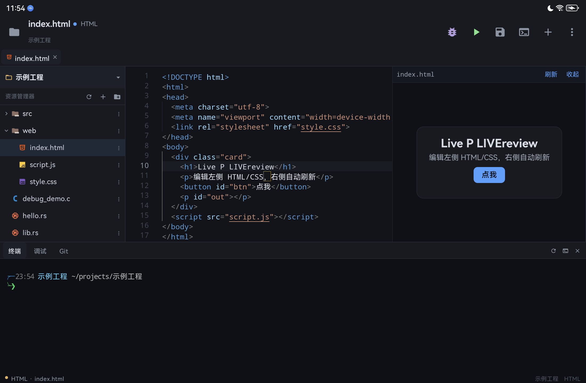

> [!WARNING]
> **项目完善中（Experimental / WIP）**
> 这个项目还在开发中，功能不完整、行为可能随时变化，**不建议现在下载日常使用**。
> 已知问题：调试器的源码级单步（一次走一行）尚未完成，目前只能按指令单步；
> 其余功能（编辑、运行、Git、预览）可用，但同样可能有 bug。
> 想尝鲜可以看 Releases，但请当作**实验版本**对待。

# CodePad

> 把 VS Code 的**编辑器**体验搬进 Android 平板：Monaco（VS Code 同款内核）+ 内置 C/C++/Rust/Python/JS 工具链，离线编译、Git 面板、HTML 实时预览。调试（gdbserver + DWARF）仍在完善中。

一个**完全离线**的 Android 平板 IDE。不需要网络、不需要 Termux、不需要 root：
工具链随 APK 一起装好，打开就能写代码、编译、下断点、提交 Git。



## 它和"手机代码编辑器"的区别

| | 常见手机编辑器 | CodePad |
|---|---|---|
| 编辑器 | 简易高亮 | Monaco（VS Code 同款） |
| 运行 | 只有脚本语言 | C/C++/Rust/Python/JS/Shell 都能真编译真跑 |
| 调试 | 打印日志 | gdbserver + DWARF（**完善中**：断点/变量/调用栈可用，源码级单步未完成） |
| 补全 | 关键词 | clangd / rust-analyzer（LSP） |
| 版本控制 | 无 | 内置 git，状态/diff/暂存/提交 |

## 功能

### 编辑
- Monaco 编辑器，语法高亮、括号匹配、多光标、查找替换
- 多标签页；标题栏一行显示「文件名 + 工程名」，不再占两行
- **全局搜索**：顶栏 🔍 直接在标题栏输入，边打边出结果（文件:行号 + 代码片段），点一下跳到对应行；自动跳过大文件/二进制/构建目录
- **设置**：编辑器字号、缩进宽度、自动换行、终端字号，改完即时生效并记住
- C/C++ 补全与悬停（clangd），Rust 补全（rust-analyzer，需 Cargo 工程）
- **跳转到定义**（F12）：⋮ 菜单触发，**支持跨文件**（从 .c 跳到 .h 的声明）





### 工程
- 顶栏 **工程** 菜单：切换 / 新建 / 导入 / 导出 / 重命名 / 删除，一处集中管理
- 一个工程 = 一个文件夹；资源管理器不再重复显示工程名
- 文件树支持拖拽移动、文件夹层级、Material 真实图标
- 模板：空工程 / C / C++·CMake / Python / Rust / Web / 多语言
- **整包导出/导入 zip**（走系统文件选择器，可存到下载目录）



### 编译与运行
- **C / C++**：clang 21 + lld，CMake 工程自动 `cmake --build`，支持多 target 选择
- **Rust**：rustc 1.100 + cargo，有 `Cargo.toml` 时走 `cargo run`
- **Python**：CPython（Chaquopy 打包，支持标准库）
- **JavaScript**：QuickJS
- **Shell**：真实 PTY（JNI forkpty），xterm.js 前端；提示符单行显示当前路径与 git 分支，面板右上可清屏 / 重启 / 收起



### 调试（完善中）

> 断点、变量、调用栈可用；**源码级单步尚未完成**（目前是逐条指令单步，体验不好）。

- 断点：点行号左侧红点，支持条件无、命中高亮
- 步进：继续 / 单步跳过 / 单步进入 / 跳出 / 停止
- 面板：局部变量、调用栈（文件:行号）
- C/C++/Rust 走 gdbserver + 自研 DWARF 解析；Python 用 `sys.settrace`；JS 用 QuickJS 行级钩子
- Rust 能展开 `String`、`Vec<T>`、结构体字段（处理了 Rust 字段重排和指针 MTE 标记）



### Git
- 内置 git 2.56.1，不依赖系统 git；首次使用解压约 13MB
- 改动列表按状态上色、点文件看单个 diff
- 单文件暂存 `＋` / 取消暂存 `－` / 丢弃 `↺`（带确认）
- 全部暂存、只提交已暂存、提交历史



### 网页实时预览
- 打开 `html`/`css`/`js` 时右侧自动出现预览侧边栏
- **未保存的改动也会即时反映**（内存覆盖，不落盘）
- 可「收起」，从 ⋮ 菜单重新打开；点 ▶ 可全屏预览



## 下载

> **实验版本，不建议日常使用。** 下面的包能装能跑，但请当作预览版。

**[⬇ 下载最新版（Releases）](https://github.com/Brot588/CodePad-Android/releases/latest)**

只提供 **arm64-v8a**，要求 Android 8.0+。

`v4.7` 的 APK 校验信息：

```
CodePad-4.7-arm64.apk   226.4 MB (237,392,931 字节)
SHA-256: 7a0721ae9352bc852c456586548145af69c37bad6655bd978f9a7430d89e7e4a
```

APK 约 226MB，因为内置了完整的 C/C++/Rust 工具链。

## 构建

需要 **JDK 17**、**Android SDK 35**、**Gradle 8.10.2**。

```powershell
# 方式一：已装好 JDK / SDK
$env:JAVA_HOME   = "C:\path\to\jdk17"
$env:ANDROID_HOME = "C:\path\to\android-sdk"
gradle assembleDebug

# 方式二：把工具链放进 ./toolchain（jdk17/ + android-sdk/ + gradle-8.10.2/）
pwsh -File .\build.ps1

# 方式三：指定工具链目录
$env:CODEPAD_TOOLCHAIN = "D:\path\to\toolchain"
pwsh -File .\build.ps1
```

`build.ps1` 只做两件事：找到工具链、设好环境变量后交给 Gradle，不含任何硬编码路径。

### ⚠️ 仓库不含内置工具链

`app/src/main/assets/` 下的 6 个 zip（约 200MB）**没有提交到仓库**：

```
tc.zip      clang/lld/gdbserver/llvm 工具 + sysroot
rust.zip    rustc + cargo + rustlib
cmake.zip   cmake + make
clangd.zip  clangd
git.zip     git
ra.zip      rust-analyzer + rust-src
```

没有它们也能编译通过，但运行时相关功能会提示"工具链缺失"。
生成方法见 [docs/c-toolchain.md](docs/c-toolchain.md)（从 Termux 的 aarch64 包提取，
并把 ELF 的 `DT_RUNPATH` 从 `/data/data/com.termux/files/usr/lib` 重写为 `$ORIGIN/../lib`）。

## 已知限制

- **仅 arm64-v8a**；`targetSdk 28`（为了能 exec 打包的二进制），所以**无法上架 Google Play**
- 平板横屏体验最佳，手机上布局局促
- 全局搜索只按内容匹配，不支持按文件名/正则/替换
- 设置项有限：字号、缩进、换行、终端字号；主题固定
- 调试器没有条件断点、watch 表达式、线程列表
- clangd 只能同文件跳转；rust-analyzer 冷启动数十秒，且可能被 Android 的 phantom process killer 回收
- 首次使用 Rust / C / Git 功能时会解压工具链，各自需要几秒到几十秒
- 不支持多窗口/分屏编辑

## 许可证

[GPL-3.0](LICENSE)。

APK 内含 GPL-2.0（git）、GPL-3.0（gdb/gdbserver、make）等第三方组件，
各组件版权与源码获取方式见 [THIRD_PARTY_NOTICES.md](THIRD_PARTY_NOTICES.md)。
